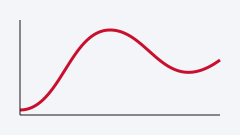
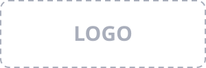

---
# Starter deck for the QUDYMA theme. Every component of the theme appears once; replace the
# placeholders in assets/ with your own art, photos and logos (keep personal photos out of
# public repos).
title: "One sentence that states the result of the talk"
author:
  - name: Carlos Payá
affiliation: "Instituto de Ciencia de Materiales de Madrid (ICMM), CSIC"
event: "Conference or seminar name"
venue: "City"
date: "1 January 2027"
paper: "<em>Journal</em> <b>1</b>, 000000 (2027)"
paper-url: "https://doi.org/10.0000/placeholder"
hero:
  - src: assets/art.svg
    class: full
logos:
  - assets/logo.svg
  - src: assets/logo.svg
    height: 84px
logo: assets/logo.svg
footer: "C. Payá · Short title · Event 2027"
format:
  qudyma-revealjs: default
---

## {#hook .hook .no-kicker}

::: {.hook-body}
[A statement the audience already believes. And why it is not the whole story.]{.hook-lead}

[The question this talk answers?]{.hook-q}
:::

::: {.notes}
(0:30) Notes start with the time budget of the slide in brackets; `deck.mjs notes` adds
them up. Say the question out loud: the conclusions answer it.
:::

# The first part {.part data-num="01" data-kicker="01 · First part" data-sub="One line on what this part sets up"}

{.part-art}

## Slide titles are assertions: they state what the slide shows

:::: {.columns}
::: {.column width="46%"}
- Few bullets, one idea each
- Math inline, $E = \sqrt{\Delta^2 + \mu^2}$, or displayed:

::: {.eq}
$$
H = \Bigl[\tfrac{p^2}{2m^*} - \mu\Bigr]\tau_z + \Delta\,\tau_x
$$
:::

::: {.fragment}
::: {.key}
**Take-away** of the slide, in one or two lines
:::
:::
:::
::: {.column width="50%"}

[A caption only when the figure needs one]{.figcap}
:::
::::

::: {.refs}
A. Author *et al.* PRL **1**, 000001 (2027) · **C. Payá** *et al.* PRB **2**, 000002 (2027)
:::

::: {.notes}
(1:00) [click] marks where the next fragment appears.
:::

## Inline labels and highlights keep the vocabulary visible

- Chips name classes, phases or cases: [class D]{.chip .red} [trivial]{.chip .green} [topological]{.chip .navy}
- Emphasis in colour: [red]{.red}, [green]{.green}, [navy]{.navy}; [muted]{.muted} and [small]{.small} text
- Highlights: [the key quantity]{.hl-red}, [the other one]{.hl-green}

::: {.fragment .fade-up}
::: {.key .green}
Take-away boxes come in `.green`, `.navy`, `.orange` and `.plain` too
:::
:::

::: {.notes}
(0:40)
:::

# Second part {.part data-num="02" data-kicker="02 · Second part" data-sub="Every slide after a part divider carries its kicker"}

{.part-art}

## Two figures side by side, each with a short lead

:::: {.columns}
::: {.column width="48%"}
::: {.card}
[Left case]{.lead}

:::
:::
::: {.column width="48%"}
::: {.card .fragment}
[Right case]{.lead}

:::
:::
::::

::: {.notes}
(1:00)
:::

## Conclusions {.no-kicker}

::: {.ccards}
::: {.ccard}

#### First result

One sentence per card
:::

::: {.ccard .fragment .fade-up}

#### Second result

One sentence per card
:::

::: {.ccard .fragment .fade-up}

#### Main result

The answer to the question of the hook
:::
:::

::: {.notes}
(1:00) Answer the hook question explicitly.
:::

## Thank you {.no-kicker .thanks}

:::: {.columns}
::: {.column width="38%"}
::: {.photo-map}
{.photo}

::: {.map-box}

[City]{.map-pin style="left:45%;top:45%"}
:::
:::

[Institute, where the photo was taken]{.figcap}

[**Carlos Payá** PhD candidate]{.whoami}

[Thesis: one line on the topic]{.thesis}

[carlosp24.github.io · carlos.paya@csic.es]{.contact}
:::
::: {.column width="58%"}
::: {.people}
::: {.group}
[Coauthors]{.group-h}

::: {.avatars}
[First Coauthor [Institute]{.muted}]{.avatar}
[Second Coauthor [Institute]{.muted}]{.avatar}
:::
:::

::: {.group}
[Supervisor]{.group-h}

::: {.avatars}
[Supervisor [Institute]{.muted}]{.avatar}
:::
:::
:::

::: {.qr}

::: {.qr-text}
[*Journal* **1**, 000000 (2027)]{.semibold} [doi.org/10.0000/placeholder]{.muted}

[Code and data on GitHub]{.muted}
:::
:::
:::
::::

::: {.funding}
::: {.inst}
 {.tall}
:::

:::

::: {.notes}
(0:20) Thank the people. [next] Back to the conclusions for questions.
:::

## Conclusions {#conclusions-qa .no-kicker}

::: {.ccards}
::: {.ccard}

#### First result

One sentence per card
:::

::: {.ccard}

#### Second result

One sentence per card
:::

::: {.ccard}

#### Main result

The answer to the question of the hook
:::
:::

::: {.notes}
Leave on screen during questions. List the backup slides here.
:::

# Backup {.part data-num="+" data-kicker="Backup" data-sub="Details kept for the questions"}

## A backup slide answers one likely question

- Same layout rules as the main slides

::: {.notes}
:::
